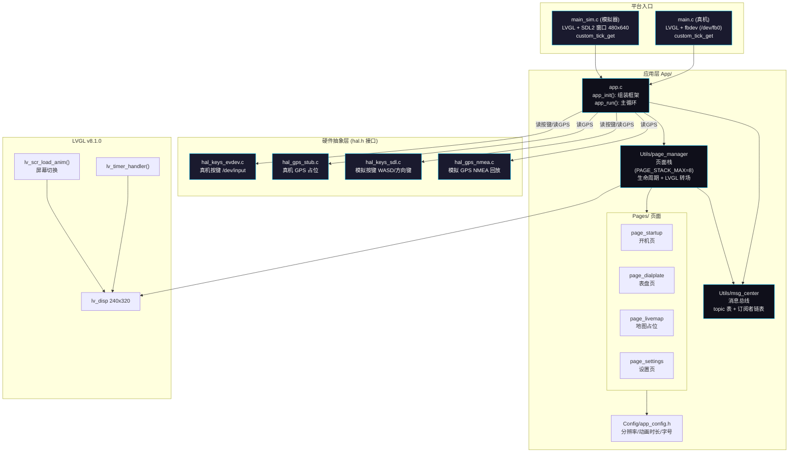

# App 框架框图 (Block Diagram)

> 说明：
> - 真机与模拟器通过 **HAL 接口**（`hal.h`）隔离，由各 Makefile 选择编译不同实现，App 层代码完全复用。
> - **消息总线**（msg_center）负责按键/GPS 事件分发；**页面管理器**（page_manager）负责页面栈与转场。
> - 页面私有 UI 数据放在 `page_t.user`，由 `create/destroy` 管理，与页面栈生命周期绑定。
