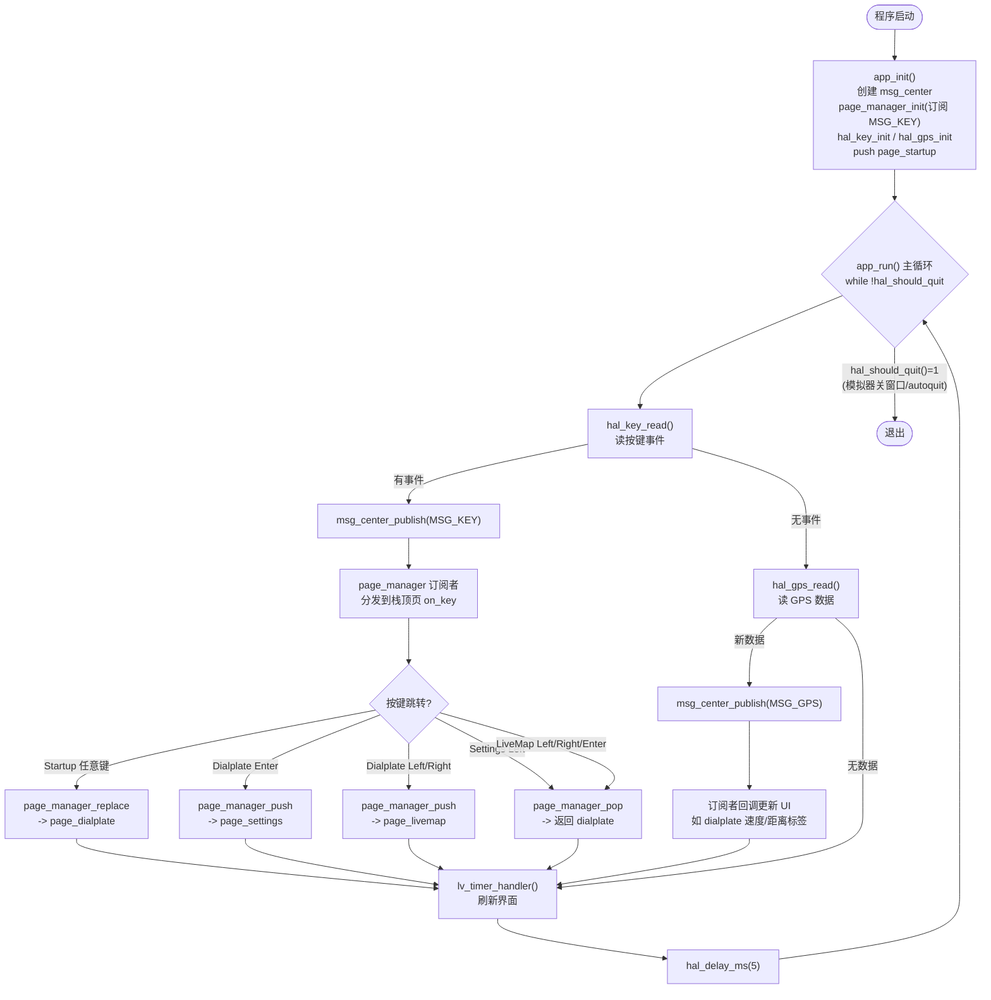
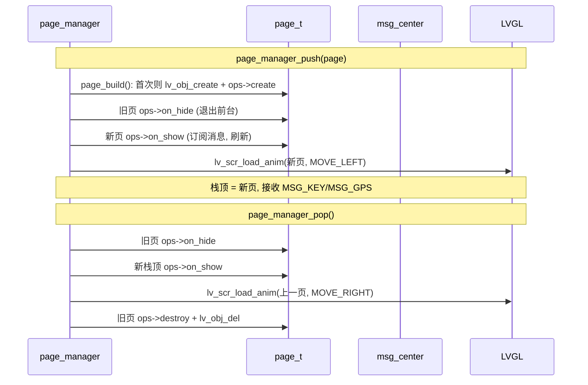
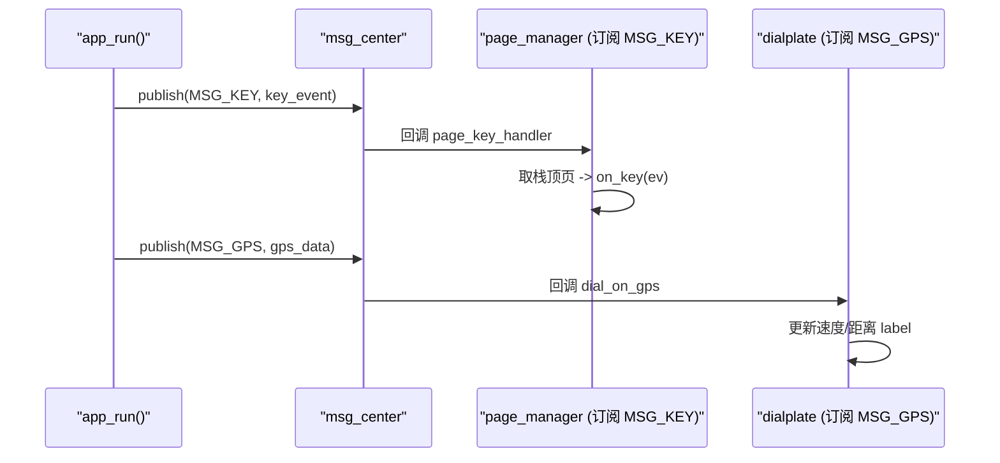

# App 运行流程图 (Flowchart)

## 1. 主循环 app_run()

## 2. 页面生命周期 (page_manager)

## 3. 消息发布/订阅时序

> 说明：
> - 按键事件统一经 `MSG_KEY` 总线，由页面管理器**按栈顶分发**，各页只需实现 `on_key`。
> - GPS 数据经 `MSG_GPS` 总线广播，表盘页在 `on_show` 订阅、`on_hide` 退订，页面隐藏时不消费。
> - 页面切换用 LVGL 转场：push 左移进入 (MOVE_LEFT)，pop 右移返回 (MOVE_RIGHT)，replace 用淡入 (FADE_ON)。
