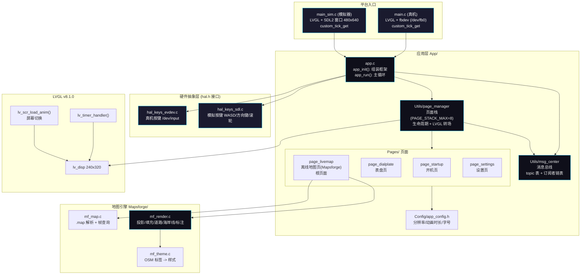

# App 框架框图 (Block Diagram)

> 说明：
> - 真机与模拟器通过 **HAL 接口**（`hal.h`）隔离，由各 Makefile 选择编译不同实现，App 层代码完全复用。HAL 当前只抽象按键（`hal_key_init/read`）与时间（`hal_delay_ms/tick_get`），GPS 尚未接入。
> - **消息总线**（msg_center）负责按键事件分发（当前仅 `MSG_KEY` 一个主题）；**页面管理器**（page_manager）负责页面栈与转场。
> - **地图引擎**（Mapsforge/）为自包含库：`mf_map` 解析 `.map` 文件并按视口 bbox 查询帧对象，`mf_theme` 将 OSM 标签映射为样式，`mf_render` 执行多遍绘制（海/陆、绿地、建筑、道路两遍、海岸线洪泛、标注）。`page_livemap` 是当前应用的根页面，直接消费地图引擎输出。
> - 页面私有 UI 数据放在 `page_t.user`，由 `create/destroy` 管理，与页面栈生命周期绑定。