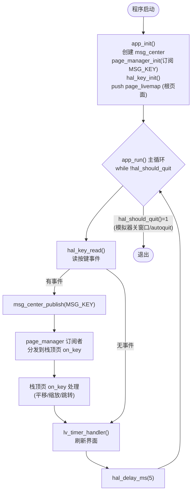
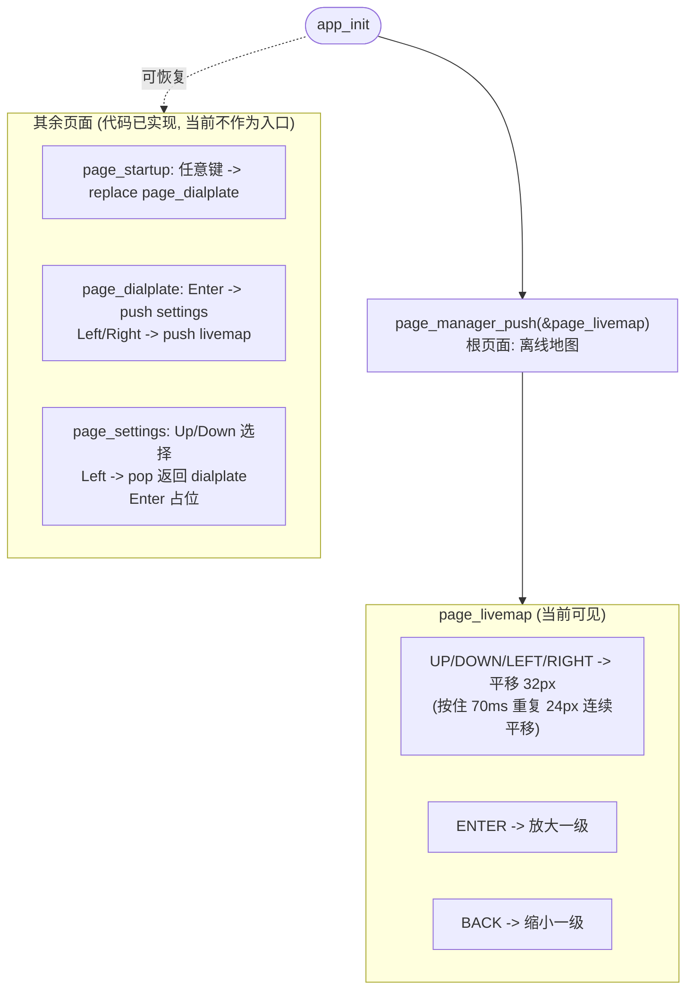
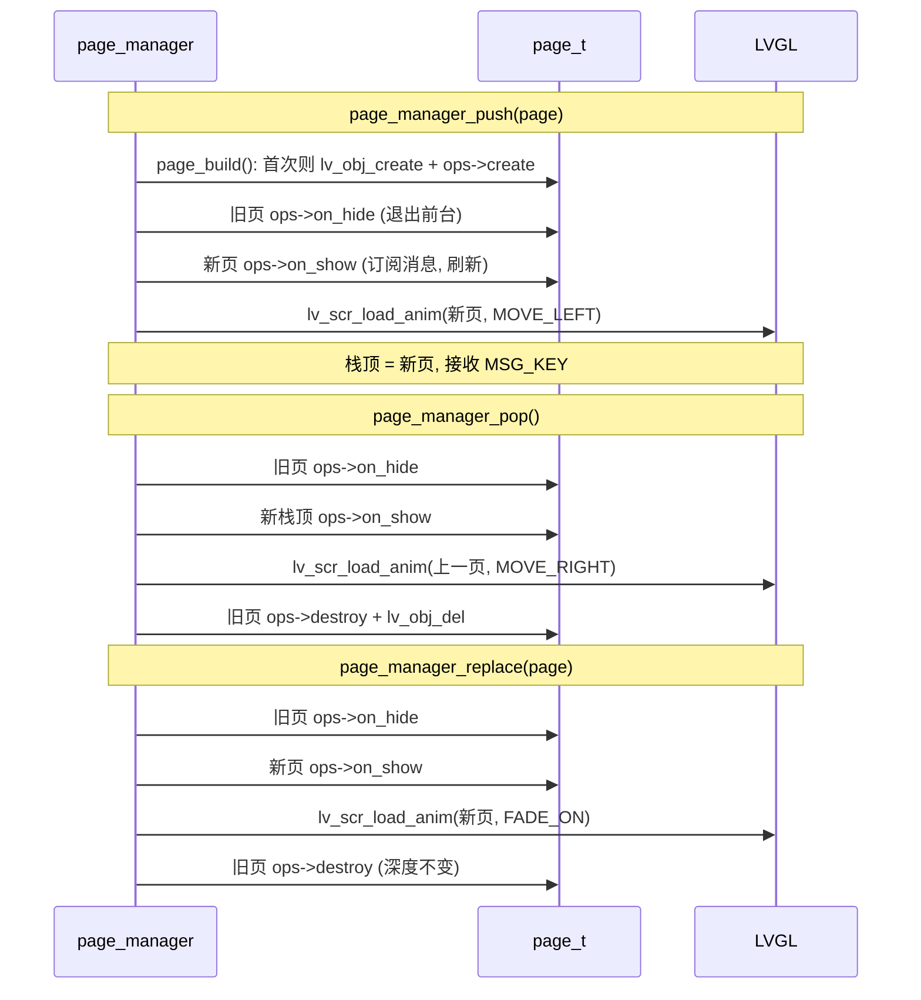
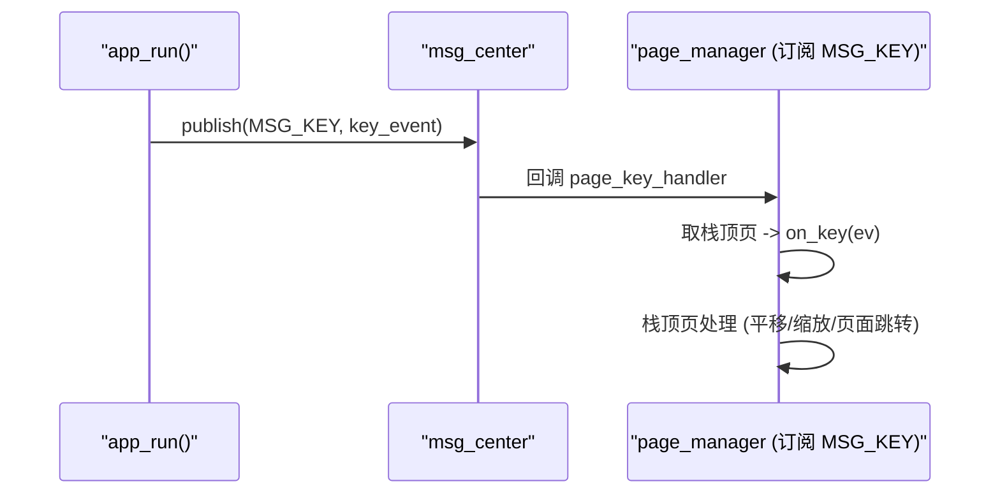

# App 运行流程图 (Flowchart)

## 1. 主循环 app_run()

> 注：当前 HAL 未接入 GPS，主循环只轮询按键，无 GPS 读取/发布。

## 2. 页面导航 (当前: 地图开发模式)

> 当前 `app_init()` 直接压入 `page_livemap` 作为**根页面**。表盘/开机/设置页仍在代码中，可经 `page_manager` 恢复，但当前入口不经过它们。

## 3. 页面生命周期 (page_manager)

## 4. 消息发布/订阅时序

> 说明：
> - 按键事件统一经 `MSG_KEY` 总线，由页面管理器在 `page_manager_init` 时订阅，回调中取**栈顶页**调用其 `on_key`；各页只需实现 `on_key`。
> - 页面切换用 LVGL 转场：push 左移进入 (MOVE_LEFT)，pop 右移返回 (MOVE_RIGHT)，replace 淡入 (FADE_ON)，时长 250ms（`PAGE_ANIM_TIME`）。